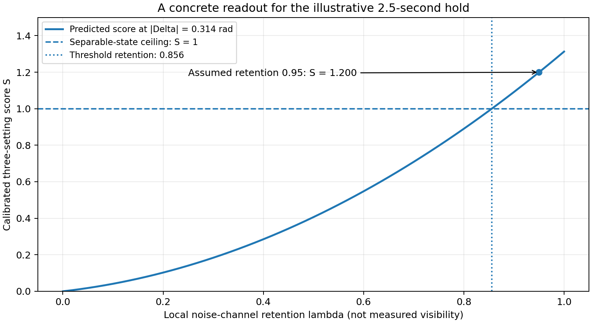

# PhysicsResearch

**Research observatory:** [Dashboard setup & Vercel deployment](dashboard/README.md) — an illustrated progress display built from committed Cycle 01 and Cycle 02 evidence. The full research program and commands remain below.

### An attempt at breakthrough physics with frontier AI

A research workspace directed by **Dion Hinchcliffe**. Its first program, **Project Gravity Witness**, asks which experimental measurements could distinguish low-energy quantum-gravity predictions from precisely specified classical or hybrid alternatives.

The organizing principle is simple: **understand the claim, inspect its assumptions, reproduce the calculation, and try to break it.** A convincing explanation is not a substitute for evidence.

[Read the research atlas](docs/atlas/2026-10-17-v0.2/atlas.md) · [View the illustrated PDF](docs/atlas/2026-10-17-v0.2/atlas.pdf) · [Open the living Google Doc](https://docs.google.com/document/d/1rkQ5z3phVVdCVBP6Obtn3HBA1U6YbQ9L78HwgeqdGAc) · [Research roadmap](projects/gravity-witness/notes/next_cycle.txt)

---

## Where the research stands

**Cycle 01: reproduction and preliminary measurement design.** [Cycle 02 physical-constraint audit](projects/gravity-witness/notes/cycle02_constraints.md) now adds a finite-sphere calculation, rigid-body non-overlap, a screening-clearance limit, and careful separation of empirical from conditional force and noise constraints. The original entangling example remains *experimentally unverified*; the physical-viability research gate stays open.

The Cycle 01 archive contains a checked two-mass calculation, a calibrated entanglement readout, a restricted classical measurement-and-feedback benchmark, and a Gaussian-smeared Diósi–Penrose countermodel. Some mathematically entangling examples have **not** yet passed physical-viability constraints.

| Evidence | Current meaning |
| --- | --- |
| 970 parameterized research checks | Numerical and software checks, including separate matrix-exponential implementations. Not 970 proofs. |
| Regenerated JSON and CSV results | Reproduced during this repository migration; compared with the frozen originals. |
| Four Lean algebra lemmas | Kernel-checked on GitHub with Lean 4.19.0; [dated compiler evidence](provenance/formal/2026-10-17/README.md) states the limited scope. |
| Five computed figures | Generated from idealized model equations, not measurements. |
| 22 Cycle 01 source records, plus a Cycle 02 source extension | Audit depth and disputed interpretations are recorded, not silently treated as established. |
| An illustrative score above 1 | Entanglement under trusted measurement assumptions—not identification of gravity as its cause. |

There is no apparatus demonstration, independent expert review, universal experimental discriminator, or unified theory claimed here. See the [full atlas](docs/atlas/2026-10-17-v0.2/atlas.md), [claim ledger](projects/gravity-witness/claims.json), [model audit](projects/gravity-witness/notes/model_audit.txt), and [failure log](projects/gravity-witness/notes/failure_log.txt).

## Choose your route

| Your goal | Best route |
| --- | --- |
| **Oversee the research without getting lost** | Read the atlas's “five-minute briefing,” Lessons 1–3, and “Two traps.” Then inspect the next review gate. No installation required. |
| **Understand the mathematics** | Read [derivations](projects/gravity-witness/notes/derivations.txt), run the small example below, then connect the equations to `gw.py` and `dp.py`. |
| **Verify the numerical results** | Follow Python setup, run the research tests, then run the non-destructive reproduction command. |
| **Check formal proofs** | Follow the separate Lean setup. Numerical success does not imply Lean success. |
| **Extend or challenge a result** | Start with [contributing](CONTRIBUTING.md) and [the evidence workflow](docs/guides/research-workflow.md); preserve negative results and counterarguments. |
| **Recover the exact original work** | Use the untouched ZIP, its manifest, and the Git history bundle under `archives/` and `provenance/`. |

## Repository map

```text
PhysicsResearch/
├── README.md                         This orientation and setup guide
├── CONTRIBUTING.md                   Research and review rules
├── requirements.lock                 Exact Cycle 01 Python dependency versions
├── pyproject.toml                    Test discovery and import configuration
├── .github/workflows/                Numerical and formal CI, kept separate
├── docs/
│   ├── atlas/
│   │   └── 2026-10-17-v0.2/
│   │       ├── atlas.md              Full two-tab atlas, readable on GitHub
│   │       ├── atlas.pdf             Native Google Docs PDF export
│   │       ├── google-export.md      Unchanged native Markdown export
│   │       ├── assets/               Four images extracted from that export
│   │       └── snapshot.json         Source ID, revision, date and checksums
│   └── guides/                       Model map, provenance and review guidance
├── projects/gravity-witness/
│   ├── src/gravity_witness/           Models and observables: gw.py, dp.py
│   ├── tests/                        The 970 original parameterized checks
│   ├── scripts/                      Figure and result generators
│   ├── formal/                       Pinned Lean project and axiom audit
│   ├── notes/                        Briefing, derivations, objections, next gate
│   ├── results/cycle01/               Frozen original JSON, CSV and test records
│   ├── figures/cycle01/               Frozen original five figures
│   ├── claims.json                   Claim IDs, status, evidence and limitations
│   └── sources.json                  Primary-source registry and audit depth
├── tools/                            Portable example, reproduce and verify commands
├── tests/                            Repository/integrity tooling tests
├── provenance/
│   ├── cycle01/                      Original manifest, README and Git bundle
│   ├── formal/                       Dated kernel-verification evidence
│   └── migration/                    Path map and actual revalidation evidence
├── archives/                         Untouched original Cycle 01 ZIP
└── build/                            Your new runs; ignored by Git
```

The project directory can coexist with future physics programs without mixing their models or results. The original source filenames are retained inside a small Python package. Historical paths in the atlas, notes and ledgers are resolved by the [migration path map](provenance/migration/path-map.json).

## Python setup

### Prerequisites

Use **Python 3.13**, Git, and enough access to clone this private repository. The original and local migration runs used Python 3.13.5. No GPU, cloud account, API key, notebook service, or paid model access is needed to run the calculations.

Initial dependency installation needs internet access. After installation, the Python example, checks and reproductions work locally without network calls. The lock pins package versions; it is **not** a hash-locked wheel or operating-system image. See [setup and troubleshooting](docs/guides/setup-and-troubleshooting.md).

Clone using your existing GitHub authentication. Do not put tokens in source files or command-line URLs.

```bash
git clone https://github.com/dhinchcliffe/PhysicsResearch.git
cd PhysicsResearch
```

### macOS / Linux

Run all subsequent commands from this repository root, with the virtual environment active.

```bash
python3.13 -m venv .venv
source .venv/bin/activate
python --version
python -m pip install -r requirements.lock
python -m pip check
python tools/example.py
```

### Windows PowerShell

```powershell
py -3.13 -m venv .venv
.\.venv\Scripts\Activate.ps1
python --version
python -m pip install -r requirements.lock
python -m pip check
python tools/example.py
```

When local policy prevents activating scripts, use the virtual environment's Python directly; no machine-wide execution-policy change is necessary:

```powershell
.\.venv\Scripts\python.exe -m pip install -r requirements.lock
.\.venv\Scripts\python.exe tools/example.py
.\.venv\Scripts\python.exe -m pytest -q
```

There is no package-build step and no need to run an editable install. Pytest and the provided runners configure the local source path. Lean is optional and has its own setup below.

## First experiment: a readable calculation

```bash
python tools/example.py
```

Expected rounded output:

```text
ILLUSTRATIVE MODEL — not an experiment or verified apparatus performance
Joint phase Δ = -0.313934 rad
Ideal concurrence C = 0.156323
Assumed local noise retention λ = 0.95
Noisy negativity N = 0.049879
Calibrated score S = 1.199515; separable ceiling = 1
```

The example assumes two point masses of 10⁻¹⁴ kg, 450 micrometres between the path-pair centres, a 250-micrometre branch split, and a 2.5-second static hold. Its noise retention is an **assumption**, not achieved apparatus performance. The calculation and interpretation are explained in the [atlas](docs/atlas/2026-10-17-v0.2/atlas.md#lesson-2--the-actual-measurement-score) and [derivations](projects/gravity-witness/notes/derivations.txt).



## Run tests and integrity checks

All commands use the Python interpreter of the active environment.

```bash
# Research calculations only: expected 970 passing parameterized checks.
python -m pytest -q projects/gravity-witness/tests

# Repository-tooling and preservation checks only.
python -m pytest -q tests

# Everything collected by the repository configuration.
python -m pytest -q

# Verify preserved archive, frozen outputs and atlas checksums.
# This command uses the Python standard library; no scientific packages required.
python tools/verify_artifacts.py
```

For focused debugging, use the exact test names shown by collection instead of guessing them:

```bash
python -m pytest --collect-only -q projects/gravity-witness/tests
python -m pytest -q projects/gravity-witness/tests/test_dp.py
python -m pytest -x -vv projects/gravity-witness/tests
```

The 970 checks are the historical research suite. Repository-tooling checks are counted separately; an increase in the total collected count is not an increase in the number of scientific theorems.

## Reproduce every figure and result without damaging the baseline

```bash
python tools/reproduce.py
```

This checks the installed dependency versions, runs the 970 research checks, regenerates the DP and two-mass outputs, performs selected SymPy checks, and compares the new numerical values with the original JSON and CSV files. It saves a timestamped directory under `build/gravity-witness/` and prints its location.

For an easily remembered destination:

```bash
python tools/reproduce.py --output build/gravity-witness/my-first-run
python tools/compare_results.py build/gravity-witness/my-first-run
```

A destination must be inside `build/` and must not already exist. This is deliberate: reruns cannot silently overwrite the frozen Cycle 01 artifacts or an earlier run.

```text
build/gravity-witness/my-first-run/
├── run.json                          Time, environment and actual pass/fail status
├── results/
│   ├── pytest.xml / pytest.txt        Fresh research-test evidence
│   ├── cycle01.json                  Main calculation and measurement distributions
│   ├── dp_reproduction.json          Countermodel predictions and caveats
│   ├── *.csv                        The plotted numerical samples
│   └── *.log                        Generator and comparison output
└── figures/                         Five newly rendered figures
```

Numerical comparison uses `rtol=1e-9` and `atol=1e-12`. Figure bytes can differ across fonts, operating systems and rendering libraries; pixel hashes are not used as a test of mathematical agreement. Dependency drift and numerical mismatches fail explicitly.

The committed [migration evidence](provenance/migration/README.md) records the actual local rerun and its limitations. Do not mistake an inherited old test XML file for evidence that your own run succeeded.

## Lean: setup, execution and what the proofs mean

The original proof draft targets **Lean 4.19.0 and mathlib v4.19.0**. These deliberately remain pinned; do not replace them with “latest” to work around a failure.

The first GitHub-hosted formal run **successfully kernel-checked all four original algebra lemmas**, without changing their statements or proof bodies. It built the project, checked the source directly, and audited each theorem's axiom dependencies. Read the [dated evidence and exact scope](provenance/formal/2026-10-17/README.md). The resolved `lake-manifest.json` is committed alongside the project.

The earlier local runtime was blocked; its report and the historical atlas remain unchanged. Those records describe an earlier environment. A Python pass or a workflow file merely existing still does not establish that a later edit passed Lean: consult the run corresponding to the actual source commit.

Install `elan`, Lean's toolchain manager, using the [official Lean installation instructions](https://lean-lang.org/install/manual/). For macOS/Linux, the following saves the installer for inspection rather than piping it directly into a shell:

```bash
curl -fsSL https://elan.lean-lang.org/elan-init.sh -o elan-init.sh
# Review elan-init.sh before executing it.
sh elan-init.sh -y --default-toolchain none
rm elan-init.sh
source "$HOME/.elan/env"
```

On Windows, follow the Windows section of the official installation page and reopen PowerShell afterward. Then, from this repository root:

```bash
python tools/check_formal.py --prepare
```

The first preparation uses the pinned mathlib release and downloads its compiled cache. The committed `lake-manifest.json` records the exact revisions from the successful verification; review any dependency-manifest diff rather than silently upgrading it. This requires network access and substantially more storage than the Python example. The runner then builds the project, checks the source directly, and prints each theorem's axiom dependencies. It saves `status.json`, `lean.log`, and the resolved dependency manifest under `build/formal/latest/`.

After dependencies are prepared:

```bash
python tools/check_formal.py
```

Equivalent manual commands:

```bash
cd projects/gravity-witness/formal
lake update
lake exe cache get
lake build
lake env lean GravityWitness.lean
lake env lean AxiomAudit.lean
```

A missing toolchain, rejected proof, explicit admission, or `sorryAx` in the axiom audit causes a nonzero exit. The repository does not hide formal failures behind `continue-on-error`. Inspect the actual theorem statements as well as successful compiler output:

| Lemma | Exact scope |
| --- | --- |
| `factors_implies_det_zero` | A coefficient array that factors as a product has zero determinant. |
| `det_zero_factors_nonzero_pivot` | Zero determinant implies a factorization **when the upper-left coefficient is nonzero**. Other pivot cases are not established by this lemma. |
| `local_factors_det` | Local diagonal factors multiply the determinant by a common scalar. |
| `phase_cancellation` | Additive phases local to either subsystem cancel in the joint phase combination. |

These are algebra statements. They do not formalize the complete concurrence formula, model viability, apparatus physics, general relativity, or quantum field theory. See the [formal project guide](projects/gravity-witness/formal/README.md). Standard Lean foundations are not the same as project-specific physical assumptions.

## Continuous verification on GitHub

[Numerical reproduction workflow](https://github.com/dhinchcliffe/PhysicsResearch/actions/workflows/numerical.yml) and [Lean kernel verification workflow](https://github.com/dhinchcliffe/PhysicsResearch/actions/workflows/formal.yml) are separate, visible checks. Relevant pushes and pull requests trigger them; each also offers **Run workflow** in GitHub's Actions tab. You can review results from an iPad without installing anything.

The numerical job installs the exact Python dependency versions on a clean runner, checks preserved bytes, runs repository checks, executes the 970 scientific checks, regenerates figures and data, and compares against the frozen originals. The formal job installs the pinned Lean environment, compiles the lemmas, checks the source, and audits the axioms. Neither job is allowed to hide a failure with `continue-on-error`.

Open a run, check its commit SHA and conclusion, then download its evidence artifact to see the actual logs and result files. Workflow artifacts are retained for 30 days; the original Cycle 01 records and selected dated verification evidence are committed permanently. A passing historical artifact does not certify a changed source file.

A clean-checkout audit caught Git normalizing two original CSVs. Their exact bytes were restored from the verified archive and `*.csv -text` now prevents that normalization. The original hashes and scientific tests were not weakened. See the [preservation audit](provenance/migration/clean-checkout-audit.md).

## Google Docs and the versioned research record

The Google Doc is the living explanatory workspace. GitHub stores an auditable snapshot alongside the code. The copy in `docs/atlas/2026-10-17-v0.2/` contains **both document tabs and all four embedded images**. `google-export.md` and `atlas.pdf` preserve the native exports; `atlas.md` changes only image reference definitions to relative files for GitHub rendering.

The snapshot intentionally preserves the document's original wording, including historical statements that a different remote was unavailable. Those describe the pre-import cycle. **PhysicsResearch is the chosen repository now.** We did not silently rewrite the scientific narrative or edit the live Google Doc during this copy operation.

`docs/atlas/.../snapshot.json` records the native document ID, revision, export time, tab identities and SHA-256 hashes. Future exports should create a new dated snapshot, verify every tab and figure, and update the atlas index. A Git commit and a Google Docs revision are different identifiers; record both. See [atlas maintenance](docs/atlas/README.md).

## Provenance, continuity and scientific boundaries

The original archive is preserved byte-for-byte at `archives/gravity-witness-cycle01.zip`. Its 37 tracked files are verified against the original manifest. The original local commit was:

```text
ea86abd353217f9c65a8b36a1945573ff8f1a796
```

Recover that history into a separate directory:

```bash
git bundle verify provenance/cycle01/history.bundle
git clone provenance/cycle01/history.bundle ../gravity-witness-original
```

This bundle is preserved historical evidence, not a claim that the original commit is an ancestor of the newly initialized PhysicsResearch branch. The [path map](provenance/migration/path-map.json) documents relocations and the small import/output-path changes. Do not use the original publish script from the archive: it targets the old repository name.

The next scientific gate remains the finite-body, cutoff, heating, force-law and shielding audit of the harder DP example. Infrastructure checks do not waive that gate. Keep the metric-noise and optical-correlation alternatives open.

## Working habits that make this useful

Before changing code, identify the claim ID, source equation and assumptions. After a change, run the focused test, the full suite and a fresh reproduction. Compare against the frozen baseline; investigate differences rather than loosening tolerances to get a green result. Update the claim ledger, source audit and failure log together.

Use pull requests for subsequent scientific changes, with a plain-language explanation and links to exact evidence. Never commit credentials, private conversations unrelated to this project, unlicensed paper PDFs, or claims that a blocked verification passed. The repository remains private; this import does not grant a public redistribution license.

Start with the atlas, not the test count. The question to keep asking is: **what observation would make this model—or our interpretation of it—wrong?**
