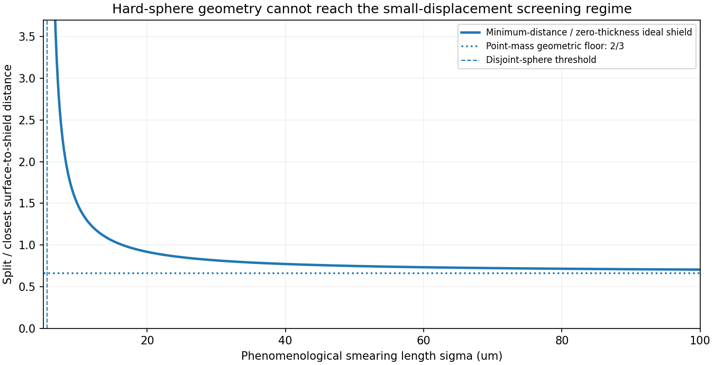
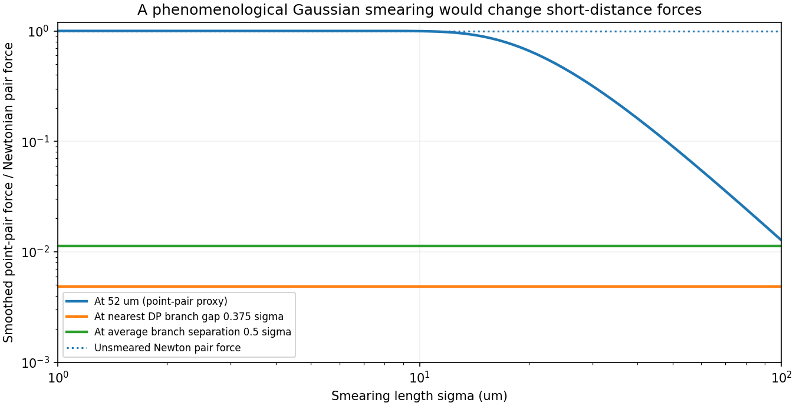

# Cycle 02 — Can the Diósi–Penrose entangling example exist in a laboratory?

17 October 2026 • Project Gravity Witness • Physical-constraints audit, phase 1

STATUS: **CONDITIONAL, COMPUTATIONALLY CHECKED; NOT CERTIFIED EXPERIMENTALLY VIABLE.**

## The five-minute finding

Our Cycle 01 implementation reproduced a published result: a particular Gaussian-smeared Diósi–Penrose (DP) dynamical model can produce entanglement in a static two-mass, four-branch state. It does **not** follow that someone can build the experiment or that entanglement alone would certify a quantum gravitational field. This cycle asks a different question: do physically extended masses, an electromagnetic shield, existing force measurements and collapse-related noise permit that configuration? [S05, S20]

**Answer for the exact example tested so far:**

1. **If the DP smearing width σ describes the object's actual mass extent (roughly its radius R), the 3σ/8 minimum centre distance forces overlapping spheres**. The example is not a physical two-body geometry under that identification. This matches the main physical-size qualification in Aspelmeyer (2026), not a contradiction of Trillo & Navascués (2025). [S05, S20]
2. **If σ is instead an independent phenomenological mass-monitoring resolution, hard-sphere nonoverlap is possible.** Our explicit uniform-sphere / Gaussian convolution leaves the initial entangling eigenvalue negative when R/σ = 0.10. Thus **finite size alone does not mathematically eliminate the more permissive version**. This is a conditional extension of the same frozen-branch model, not a new experiment or a novelty claim.
3. **Screening is the hard constraint.** Under a thin centered Faraday shield, the ratio of the spatial superposition to the smallest possible surface-to-screen clearance is `2 L/(d − 2R)`; in the paper's fixed example `d = 3σ/8`, `L = σ/8`. Every non-overlapping implementation obeys `2 L/(d − 2R) > 2/3`, not «much smaller than one». Aspelmeyer argues small superposition relative to distance from the shield is needed to suppress image-charge which-path decoherence. We have not calculated actual charged/dipole decoherence, so **this is a conflict with a proposed practical shielding regime, not an all-experiments impossibility theorem**. [S20]
4. **The model's Gaussian potential is very soft at its own branch distances**: point-pair force is only 0.486% of Newton at the closest branch gap (`0.375σ`) and 1.132% at the mean centre distance (`0.5σ`). But comparing such model behavior with the 2020 52-μm torsion-balance experiment requires the **full extended attractor/detector geometry and likelihood**, not a point-pair surrogate. Aspelmeyer notes short-distance Newton tests as a promising route for bounding σ. A precise exclusion of our σ choices is **not established yet**. [S05, S20, S25]
5. **Independent heating and X-ray constraints are important but do not close this micrometre-scale case.** The 2026 XENONnT paper reports, for its Markovian DP model, a 95%-confidence *lower* bound `R₀ > 4.5×10⁻¹⁰ m`. This is many orders of magnitude below our illustrative micrometre σ. Parameter conventions and noise models must be matched before making a single combined allowed region. The upper cutoff suggested by some macroscopic-classicality analyses is a **theory criterion**, not an empirical upper limit. [S23, S24, S27]

**Decision: Gate 03 remains IN PROGRESS.** We have screened one mathematically entangling example against simple physical constraints and built a reproducible finite-sphere extension; there is not yet a certified surviving experimental parameter window nor a universal exclusion of DP models.

## Lesson 1 — Three distances, not one

In the original Trillo & Navascués inline construction, A occupies 0 or L; B occupies d+L or d+2L. Thus `d` is the **minimum** branch-centre separation. The **mean** centres are separated by `d+L`. The four branch pair distances are `d, d+L, d+L, d+2L` (up to their order). This must not be confused with the parameter d in our *different* Cycle 01 Newtonian geometry, which is a mean centre distance.

For the exact entangling example, `d/σ=3/8=0.375` and `L/σ=1/8=0.125`. Two non-interpenetrating rigid spheres of radius R require `d>2R`, hence `σ > (16/3)R ≈5.333R`. That inequality alone excludes **σ≈R** while leaving a possible geometry for phenomenological `σ≫R`. [S05, S20]

For a *hypothetical* 10⁻¹⁴ kg silica sphere with density 2,200 kg/m³ (a scenario, not a proposed commercial part), `R=1.0276 μm` and the strict nonoverlap edge is `σ>5.4806 μm`. At `σ=10 μm`, we get `d=3.75 μm`, `L=1.25 μm`, and nearest surface gap `d−2R=1.695 μm`. Gold density 19,300 kg/m³ gives `R=0.4983 μm` and nonoverlap edge `σ>2.6574 μm`. We do not conclude that micrometre superpositions of these objects are currently achievable.

## Lesson 2 — Why the conducting shield matters

A conducting sheet can suppress electromagnetic interactions masquerading as gravity; the same sheet can introduce decoherence from image charges, residual electric dipoles, surface defects and finite-temperature fluctuations. Aspelmeyer's analysis argues for spatial displacement much less than the distance to the shield. [S20]

For an ideal zero-thickness sheet centered in the *smallest* gap between equal spheres, its free clearance from either closest surface is `(d−2R)/2`. The dimensionless screening stress is therefore `Q=2L/(d−2R)`. Since `d−2R<d`, `Q>2L/d=2/3`. At `m=10⁻¹⁴ kg`, silica density, `σ=10 μm`, the value is `Q=1.475`. A finite-thickness screen further reduces the free gap. This quantity is not a measured decoherence factor and there is no published precise universal threshold `Q<0.1`; «much less» is qualitative. In particular, a different arrangement without a conducting sheet might avoid this argument, but must then quantitatively suppress electromagnetic contamination another way.

## Lesson 3 — A controlled finite-size extension

Trillo & Navascués use Gaussian-smeared point masses, with dimensionless kernel `σ f(r)=erf(r/(2σ))/(r/σ)`. To test how much their four-branch *instantaneous entangling eigenvalue* depends on treating each body as a mathematical point, we replace the mass distribution with a uniform rigid sphere of radius R **convolved with the same Gaussian**. The normalized Fourier form factor of a homogeneous sphere is `F(z)=3(sin z−z cos z)/z³`. The dimensionless pair kernel becomes

`σ f_R(r) = (2/π) ∫₀∞ dq exp(−q²) F(qR/σ)² sinc(qr/σ)`.

We integrate this even function using 96-point Gauss–Hermite quadrature and construct the full 4×4 mass-density Gram matrix, including self and cross terms. The initial partial-transpose eigenvalue reproduces the published point result as `R→0`: `E₋/[Gm²/(2ℏσ)] = −0.0001915639956` at `(d,L)/σ=(3/8,1/8)`.

At `R/σ=0.10`, the extended-sphere value is `−0.000191206279`; at `R/σ=0.18`, it is `−0.000190407305`. Both remain negative in the fixed-position, two-qubit subspace. Independent quadrature orders (96 and 128) agree over the tested range. This is **not a finite-body experiment simulation**: it omits free COM dynamics, particle preparation, traps, internal noise, thermal decoherence, collisions, electromagnetic and Casimir forces, and readout.

The result makes the critical distinction precise: **finite solid radius is not automatically enough to erase DP's mathematical entangling onset when σ can be chosen larger than R.** The serious challenge then shifts to the interpretation and allowed size of σ and to maintaining coherence and screening simultaneously.

## Lesson 4 — Compare against existing physical measurements, without cheating

For the specific jointly smeared pair *potential* `−Gm₁m₂ erf[r/(2σ)]/r`, the gravitational force relative to Newton's point-mass force is

`Fσ/FN = erf(x)−(2x/√π)exp(−x²)` where `x=r/(2σ)`.

At the example's nearest branch gap `r=0.375σ`, this ratio is `0.0048554`. At its mean branch-centre distance `r=0.5σ`, the ratio is `0.0113229`. These dramatic changes are predictions of this **specific** coupling kernel at distances deep below σ, not new measured effects.

Lee et al. (2020) tested the inverse-square law using torsion-balance attractors and detector bodies with the closest *surface* separation 52 μm. Their published exclusion curve is for **Yukawa** corrections and extended source bodies. The chart's response at a hypothetical `r=52 μm` is explicitly a point-pair illustrative proxy, **not** an extraction of a 95% exclusion on Gaussian σ from their data. [S25]

Separate noise constraints: Vinante & Ulbricht give the original Gaussian/white-noise DP single-mass heating formula `P=G ℏ m/(4√π σ³)`. With 10⁻¹⁴ kg and σ=10 μm this is about 9.93×10⁻⁴⁵ W. It is so small because a large σ cubically suppresses heating; this does **not** imply a macroscopic composite particle can be modeled as one constituent or that thermal/environmental decoherence is negligible. XENONnT's 2026 `R₀>0.45 nm` bound is model-conditional and excludes much smaller cutoffs than the illustrative σ. New 2026 work further finds that Gaussian smearing is not the least-heating choice for DP, another reason to avoid falsely universal statements. [S23, S24, S26]

## A few illustrative parameter settings

All masses 10⁻¹⁴ kg, rigid silica density 2,200 kg/m³; figures below are rounded. The time is conversion of the *dimensionless* Cycle 01 numerical DP peak at `u≈407.93`, assuming the static model can apply indefinitely. It is **not** a coherence-time prediction.

| σ (μm) | d (μm) | L (μm) | Hard spheres | Q=2L/(d−2R) | Static peak time (s) |
|---:|---:|---:|:---|---:|---:|
| 5 | 1.875 | 0.625 | overlap | undefined | 64.5 |
| 10 | 3.75 | 1.25 | separate | 1.475 | 128.9 |
| 20 | 7.50 | 2.50 | separate | 0.918 | 257.8 |
| 50 | 18.75 | 6.25 | separate | 0.749 | 644.5 |

Interpretation: increasing σ helps fit spheres, but Q never approaches zero in this chosen scale-invariant geometry. Meanwhile the model's intrinsic entanglement signal is modest and requires sustained coherence. The table is **not** a prospective apparatus specification.

## The research stoplight

**Verified within model:** published point-onset value, finite-sphere limiting reduction, hard-sphere inequality, geometric Q bound, derived softened force fraction and ideal single-mass heating scaling. 40 independent new parameterized checks exercise these results. [S05, S20, S24]

**Persuasive but not a decisive experimental exclusion:** the gap/screening conflict for this geometry, under the source's assumption that a conducting screen and negligible which-path information are necessary. No Maxwell/Johnson noise calculation is performed. [S20]

**Still open:** exact 2020 gravity-data reinterpretation as Gaussian force smearing; colored-noise and non-Gaussian DP variants; σ convention across experiments; realistic wavepacket/finite object dynamics and coherence budget; any electromagnetic shielding alternatives; the 2026 locality critique. [S08, S25, S26]

## What you can do in the real world

The most valuable next step is **a 30-minute technical review with someone actively designing tabletop GIE experiments**. We need specific engineering numbers: target mass/material/radius, achievable coherent spatial split, achievable coherence duration, closest centre and surface distances, screen position/thickness, residual charge/dipole noise, and an experimentally validated bound on non-gravitational couplings.

Three technically focused questions to send a researcher (not yet sent):

* Given `L/d = 1/3` in our Trillo geometry, is a Faraday screen even credible without fatal which-path decoherence? What shield-free/alternate-screen geometry is best supported?
* Is a *phenomenological* Gaussian DP cutoff `σ≫R` compatible with the published torsion-balance data when the whole attractor-detector mass distribution and exact smoothing convention are fitted? Can they share a response kernel or limits?
* What are the strongest experimentally demonstrated **simultaneous** mass, superposition separation, and coherence-time combinations? Please distinguish demonstrated records from projections.

The nearest source contacts disclosed in the published papers are **Markus Aspelmeyer** (University of Vienna), **David Trillo** (CUNEF Universidad, Madrid) and **Miguel Navascués** (Austrian Academy of Sciences). We should invite a critique of assumptions rather than pitch a discovery. Do not send outreach or spend money without approval.

## Next computational gate (Cycle 02b)

A legitimate “constraint survives” claim will require (1) finite-body Diósi–Penrose *moving* states, (2) realistic electromagnetic shield or a quantified substitute, (3) reconstruction of published precision-gravity likelihood for σ, (4) independently constrained noise/thermal decoherence, and (5) matched model distributions with a prespecified discrimination criterion. If these cannot coexist, record a narrow no-go result with assumptions. Otherwise test alternative transverse and atom-interferometer geometries.

## References and checks

[S05] Trillo & Navascués (2025), *Phys. Rev. D* **111**, L121101, https://arxiv.org/pdf/2411.02287v2 (Eqs 8–20, geometry)

[S20] Aspelmeyer (2026), *Comptes Rendus Physique* **27**, 1–6, https://doi.org/10.5802/crphys.270 (Eqs 1–4; geometric, shield and σ interpretation)

[S23] XENONnT Collaboration (2026), *Phys. Rev. Lett.* **136**, 120201, https://doi.org/10.1103/2jm3-4976 (95% DP cutoff lower bound; Markovian noise)

[S24] Vinante & Ulbricht, *Gravity-related collapse and spontaneous heating* (2021), https://arxiv.org/abs/2109.14980 (Gaussian DP heating, Eq 1)

[S25] Lee et al. (2020), *Phys. Rev. Lett.* **124**, 101101, https://doi.org/10.1103/PhysRevLett.124.101101 (torsion-balance force law at 52 μm)

[S26] Piccione et al. (2026), *Phys. Rev. A* **113**, 062211, https://doi.org/10.1103/h74z-zvfv (optimal smearing differs from Gaussian for DP)

[S27] Figurato et al. (2024), *New J. Phys.* **26**, 113004, https://doi.org/10.1088/1367-2630/ad8c77 (macroscopic-classicality criterion, conditional upper cutoff)

Reproduce with `PYTHONPATH=projects/gravity-witness/src python projects/gravity-witness/scripts/run_constraints.py`. The runner writes to untracked `build/gravity-witness/cycle02/` and does not modify preserved Cycle 01 results. Tests: `python -m pytest -q projects/gravity-witness/tests/test_constraints.py`.
